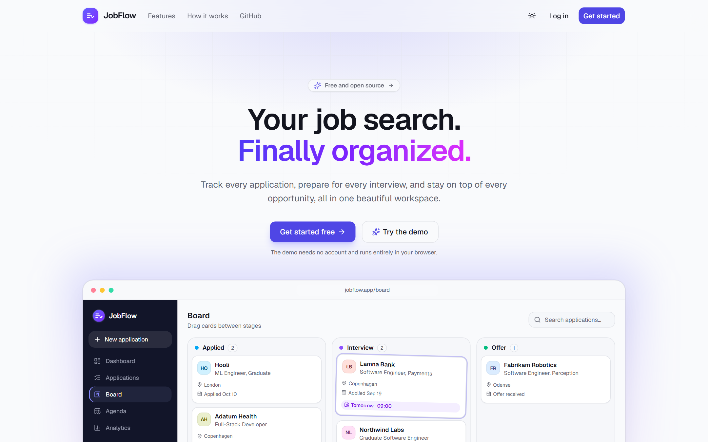
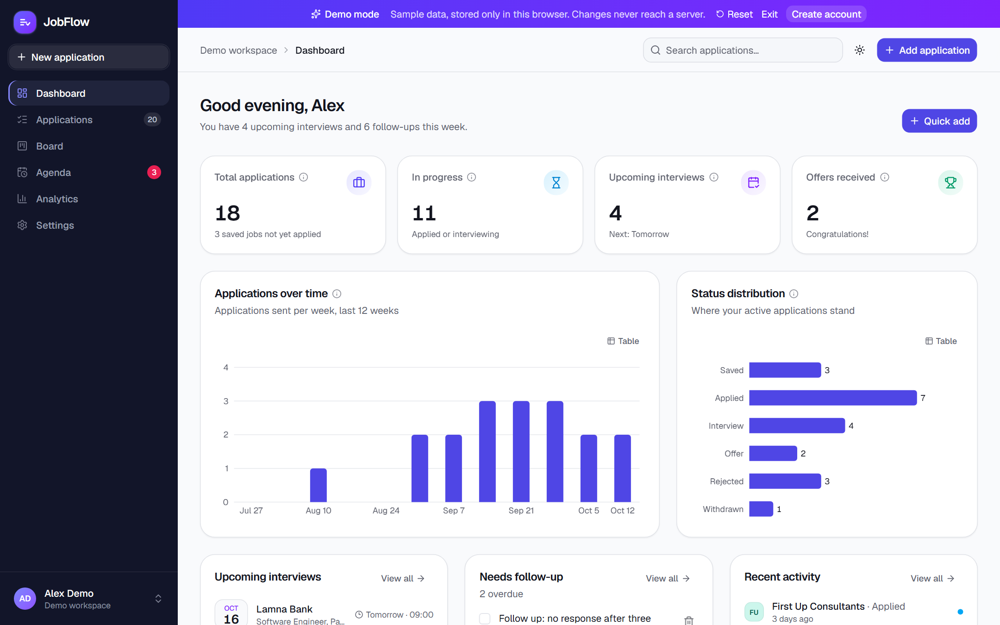
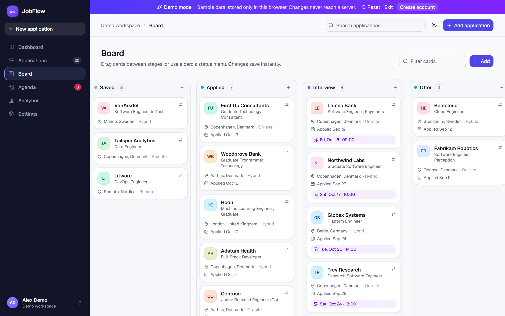
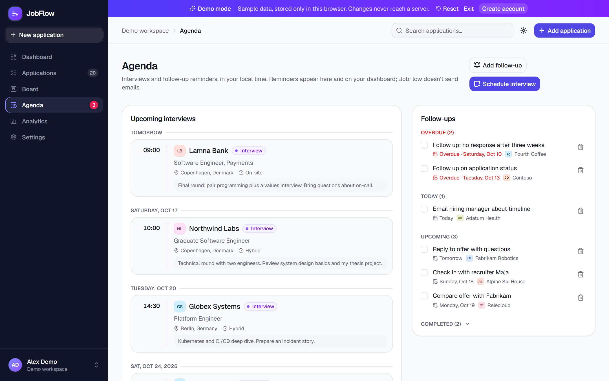
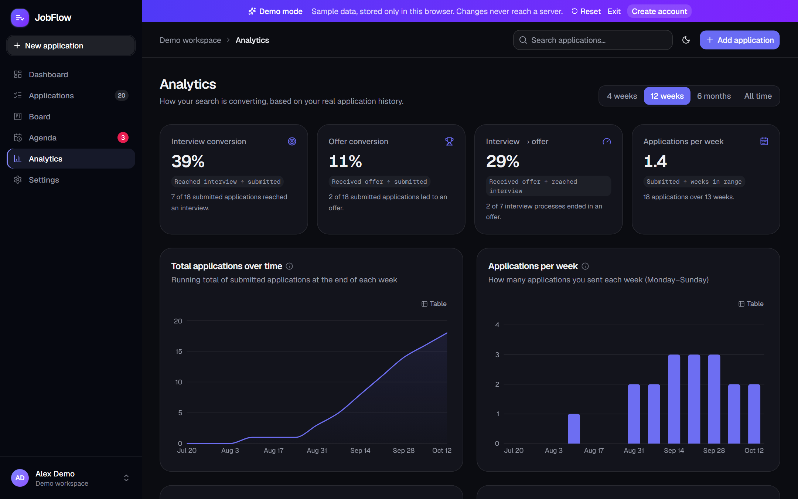
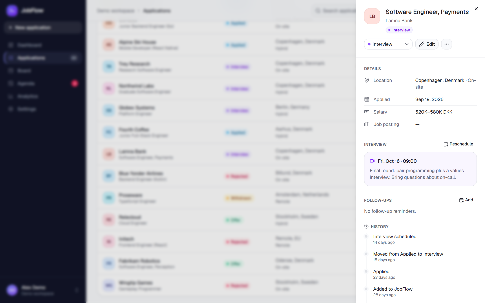
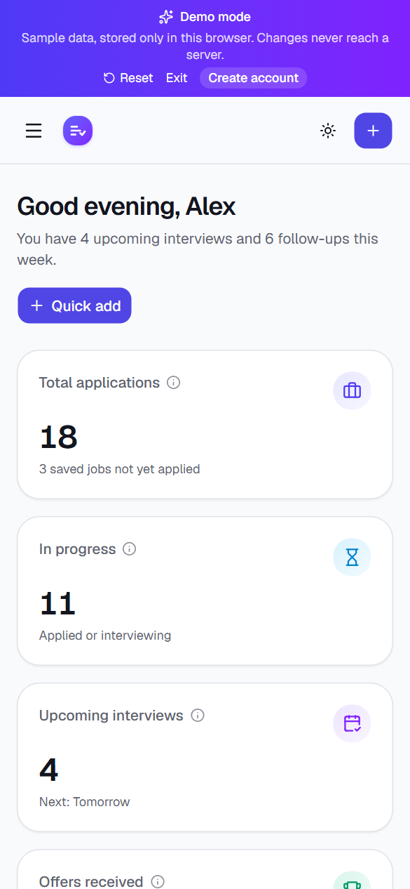
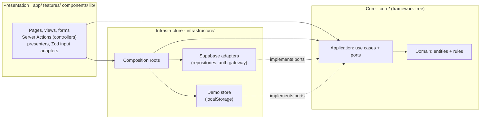

<div align="center">

# JobFlow

**Your job search. Finally organized.**

A full-stack job application tracker with a drag-and-drop pipeline, an interview agenda and analytics computed from your real application history.

[](https://github.com/SqushiLoL/jobflow-application-tracker/actions/workflows/ci.yml)


[](LICENSE)

[Quick start](#quick-start) · [Features](#features) · [Architecture](docs/architecture.md) · [Decision records](docs/adr/) · [Testing](#testing)

</div>



> **Try it without an account:** run it locally (see [Quick start](#quick-start)) and click **Try the demo**. Demo mode needs no database and works in under a minute.

---

## At a glance

| | |
|---|---|
| **Stack** | Next.js 16 (App Router) · React 19 · TypeScript (strict) · Tailwind CSS 4 · shadcn/ui · Supabase (Auth, Postgres, RLS) · Recharts · dnd-kit · React Hook Form + Zod |
| **Security** | Row Level Security on every table, verified by automated tests against the real migration |
| **Architecture** | Clean Architecture and SOLID: ports and adapters, pure dependency injection, read-model queries. The dependency rule is enforced by ESLint. [Read more](docs/architecture.md) |
| **Testing** | 110 Vitest tests (domain, use cases with in-memory fakes, queries, adapters, a React form, database RLS) with a 95% coverage gate on the core, plus 24 Playwright end-to-end tests on desktop and mobile |
| **CI** | GitHub Actions: lint (including architecture rules), type-check, unit tests with coverage, production build, then end-to-end tests |
| **Demo mode** | ~20 realistic fictional applications stored only in the visitor's browser, so it works without Supabase |



## Features

- **Authentication** with Supabase: sign up, log in, log out, password reset by email, persistent cookie sessions, protected routes checked on the server, and a profile with name and avatar initials.
- **Application management**: create, view, edit, delete, withdraw and archive applications. Each one stores company, title, logo (or generated initials), location, work type, posting URL, status, applied date, interview time and notes, salary range and currency, and personal notes. Forms validate with Zod and show inline, accessible errors.
- **Kanban board**: drag cards between Saved → Applied → Interview → Offer → Rejected. Updates are optimistic and **rolled back automatically if the save fails**. Every card also has a status menu as a keyboard and screen-reader friendly alternative to dragging, and the board scrolls horizontally on small screens.
- **Search, filters and sorting**: accent-insensitive search across company, title and location, combined with status, work type, applied-date range and an archived toggle. Sort by newest, oldest, company or upcoming interview, and clear everything in one click.
- **Agenda**: upcoming interviews grouped by day in the viewer's local time zone, plus follow-up reminders split into overdue, today, upcoming and completed groups.
- **Dashboard**: four live metrics, applications over time, status distribution, upcoming interviews, follow-ups due, recent activity and a quick-add button.
- **Analytics**: cumulative applications, applications per week, status distribution, weekly activity trend, and interview/offer conversion rates. Each formula is shown next to its number, and every chart can be switched to a data table.
- **Polish**: light, dark and system themes; loading skeletons; empty states; toasts; responsive down to phone width; keyboard focus states; respects reduced motion.

| Board | Agenda |
|---|---|
|  |  |
| **Analytics (dark mode)** | **Application detail** |
|  |  |

<p align="center"></p>

## Quick start

Requires Node.js 20.9+ (CI uses Node 24).

```bash
git clone https://github.com/SqushiLoL/jobflow-application-tracker.git
cd jobflow-application-tracker
npm install
npm run dev
```

Open <http://localhost:3000> and click **Try the demo**. Without Supabase credentials, the demo works fully and account pages explain that sign-up is disabled.

### Connecting Supabase (real accounts)

1. Create a project at [supabase.com](https://supabase.com).
2. Apply the schema: open **SQL Editor**, paste [`supabase/migrations/20261015000000_initial_schema.sql`](supabase/migrations/20261015000000_initial_schema.sql) and run it. With the Supabase CLI, `supabase link` followed by `supabase db push` does the same.
3. Under **Authentication → URL Configuration**, set **Site URL** to your app URL and add `http://localhost:3000/auth/callback` (plus your production `/auth/callback` URL) to **Redirect URLs**.
4. Copy `.env.example` to `.env.local` and fill it in from **Project Settings → API**:

| Variable | Required | Description |
|---|---|---|
| `NEXT_PUBLIC_SUPABASE_URL` | for accounts | Project URL |
| `NEXT_PUBLIC_SUPABASE_PUBLISHABLE_KEY` | for accounts | Publishable (anon) key. Safe in the browser because RLS controls access. `NEXT_PUBLIC_SUPABASE_ANON_KEY` is also accepted. |
| `NEXT_PUBLIC_SITE_URL` | in production | Public URL used in auth email links. Locally it falls back to the request origin. |

The app never uses the **service-role key**. Don't add it to any environment.

## Scripts

| Command | What it does |
|---|---|
| `npm run dev` | Start the dev server |
| `npm run build` / `npm start` | Production build / serve it |
| `npm run lint` | ESLint (Next.js core-web-vitals + TypeScript rules) |
| `npm run typecheck` | Generate Next.js route types, then `tsc --noEmit` |
| `npm test` | Run all Vitest tests once |
| `npm run test:coverage` | Vitest with the coverage gate on `src/core` |
| `npm run test:e2e` | Production build + Playwright end-to-end tests (demo mode, no Supabase needed) |
| `npm run check` | Lint + typecheck + tests |

## Architecture

JobFlow follows **Clean Architecture** and applies **SOLID** where it pays off: business rules sit at the centre, and every dependency points inward. The full write-up, including how each SOLID principle maps to concrete files, the design patterns used, and where principles were deliberately *not* applied, is in **[docs/architecture.md](docs/architecture.md)**. Key decisions are recorded as **[ADRs](docs/adr/)**.



| Layer | Folder | Contains | May depend on |
|---|---|---|---|
| **Domain** | `src/core/domain` | Entities (`Application`, `FollowUpTask`…) and pure rules: status transitions, applied-date invariant, interview scheduling, metrics, filtering, history derivation | nothing (only `date-fns`) |
| **Application** | `src/core/application` | Use cases (`create`, `move`, `scheduleInterview`, `toggleCompleted`, `signIn`…), **queries** that build each screen's read model, **ports** (`ApplicationRepository`, `FollowUpRepository`, `ActivityLog`, `ProfileRepository`, `AuthGateway`, `Clock`), core error types | domain |
| **Infrastructure** | `src/infrastructure` | Supabase repositories and auth gateway, error translation, the browser-local demo store, the proxy session helper, **composition roots** that wire adapters into use cases (pure DI, no container) | core |
| **Presentation** | `src/app`, `src/features`, `src/components`, `src/lib` | Next.js routes, React views, Server Actions as controllers, presenters (labels, colours, formatting), Zod schemas that turn form strings into use-case input | core, and infrastructure **only via** `infrastructure/composition` |

**The dependency rule is enforced, not just documented.** `eslint.config.mjs` uses `no-restricted-imports` per layer: the core can't import React, Next.js, Supabase, Zod or any outer folder, and the UI can't import a Supabase adapter directly. A violation fails `npm run lint` and therefore CI.

**How a change flows.** Dragging a card calls `applications.move(app, "interview")`. The use case applies the domain rules and returns a `PendingChange` holding the `preview` (what the application will look like) and `commit()` (persist it). The UI renders the preview at once, awaits `commit()`, and restores the previous version if it rejects. Optimistic UI stays in the presentation layer while every business decision stays in the core.

**Two backends, one core.** The composition root picks the adapters:

- **Signed-in users** get the Supabase repositories. Queries run with the user's session, so Postgres RLS decides what is visible.
- **Demo visitors** get `DemoRepository`, which implements the same ports on top of `localStorage` and reproduces the database's cascades and history trigger. It can't reach Supabase, so demo users are isolated from real accounts and from each other.

Use cases and components never branch on the mode.

**Auth.** `proxy.ts` refreshes the session cookie and redirects unauthenticated visitors. The dashboard layout then asks the auth use case for the current user, which the Supabase gateway verifies with `getUser()`. Server Actions act as controllers: they validate input with Zod, call the auth use case, and map typed failures (`invalid_credentials`, `rate_limited`…) to messages. No Supabase error string reaches the UI.

```
src/
  core/
    domain/               Entities and pure business rules
    application/
      ports/              Interfaces the core needs (repositories, auth, clock)
      use-cases/          Application, follow-up, workspace and auth use cases
      queries/            Read models for dashboard, analytics, agenda and board
  infrastructure/
    supabase/             Clients, repositories, auth gateway, row mappers, DB types
    demo/                 localStorage store + sample-data seed
    composition/          client.ts / server.ts: the only places adapters are wired up
  app/                    Next.js routes (marketing, auth, dashboard), callback and demo routes
  features/               Feature UIs and controllers (dashboard, kanban, agenda, analytics, auth…)
  components/             Shared UI: shadcn/ui primitives, charts, layout
  lib/                    Presenters, form/date input adapters, Zod schemas, route constants
  proxy.ts                Next 16 proxy (formerly middleware)
supabase/migrations/      SQL schema, triggers and RLS policies
tests/                    Unit, use-case, query, adapter, component and database tests
e2e/                      Playwright end-to-end tests
docs/                     Architecture guide and decision records
```

## Database design

```
auth.users ─┬─< profiles              (1:1, created by trigger on sign-up)
            ├─< applications ─┬─< follow_up_tasks       FK (application_id, user_id)
            │                 └─< application_activity  FK (application_id, user_id)
```

- **`applications`**: one row per job. `status` is limited by a CHECK to `saved | applied | interview | offer | rejected | withdrawn`. `date_applied` is a `date` (a calendar day, so it never shifts across time zones). `interview_at` and `archived_at` are `timestamptz`. CHECKs also cover text lengths, `http(s)` URLs, salary ≥ 0 with max ≥ min, and ISO currency codes.
- **`follow_up_tasks`**: reminders with `due_at` and a nullable `completed_at`.
- **`application_activity`**: an append-only history of creation, status changes, scheduled interviews and archiving. Analytics read it, for example to count an application that reached an interview before being rejected.
- **`profiles`**: display name, created by a `security definer` trigger when a user signs up.

Key decisions:

1. **Ownership is enforced twice.** RLS policies on every table limit `select/insert/update/delete` to rows where `user_id = auth.uid()`. Child tables also use a **composite foreign key `(application_id, user_id)`**, so the database itself rejects a follow-up attached to someone else's application.
2. **History can't be forged.** A trigger writes activity rows. It runs as `security definer`, and users have no INSERT policy on the table, so a client can read its history but can't write fake events.
3. **Archive vs. delete.** Archiving sets `archived_at` and keeps everything. Deleting cascades to follow-ups and history, and the UI says so in the confirmation dialog.
4. **Indexes** match the access patterns: `(user_id, status)`, `(user_id, date_applied)`, partial indexes on upcoming interviews and open follow-ups, and `(user_id, occurred_at)` for the activity feed.
5. **RLS performance.** Policies use `(select auth.uid())` so Postgres evaluates it once per query, not once per row.

`tests/database/rls.test.ts` runs the **real migration** in an in-process Postgres ([PGlite](https://pglite.dev)) with a stand-in for Supabase's `auth` schema. It then acts as two users to prove the isolation guarantees above, the constraints, the triggers and the cascades.

## Metric definitions

| Metric | Definition |
|---|---|
| Total applications | Every application with a status other than *Saved*. Rejected, withdrawn and archived applications still count because they were sent. |
| In progress | *Applied* or *Interview*, not archived |
| Upcoming interviews | Interview time in the future, on an application that isn't rejected, withdrawn or archived |
| Offers received | Status *Offer*, not archived |
| Interview conversion | applications that ever reached an interview ÷ submitted applications |
| Offer conversion | applications that ever reached an offer ÷ submitted applications |
| Interview → offer | reached offer ÷ reached interview |

"Ever reached" uses the activity history, so an application rejected after an interview still counts as reaching the interview stage. When the denominator is zero, rates show "—" instead of dividing by zero. Weeks start on Monday and use the viewer's time zone.

## Testing

```bash
npm test
```

| Suite | Covers |
|---|---|
| `validation.test.ts` | Application, follow-up and auth schemas; string → domain conversion including time-zone handling |
| `status.test.ts` | Status classification, transition rules (auto-dated applications, non-linear moves), activity derivation |
| `metrics.test.ts` | Dashboard metrics, conversion rates with empty data, weekly bucketing, cumulative totals, follow-up grouping |
| `filters.test.ts` | Search, combined filters, date ranges, every sort option |
| `queries.test.ts` | Read models: what "needs follow-up" means, analytics range membership, day grouping in local time, board ordering |
| `errors.test.ts` | Supabase errors translate to core errors; presenters never leak internal messages |
| `use-cases.test.ts` | Every use case against in-memory port fakes: preview vs. commit, rollback on failed commit, validation, interview scheduling, auth flows (no account enumeration on password reset) |
| `demo-repository.test.ts` | The demo adapter honours the port contracts: persistence across reloads, history like the DB trigger, cascades, foreign-key behaviour, corrupt-storage recovery |
| `job-reducer.test.ts` | Optimistic update + rollback, cascading removal |
| `application-form.test.tsx` | Form validation, accessible error states and submission (React Testing Library) |
| `database/rls.test.ts` | RLS isolation between users, composite-FK ownership, activity forging, triggers, constraints, cascades |

The test run pins `TZ=Europe/Copenhagen`, so date assertions behave the same on every machine and in CI.

**End-to-end** (`npm run test:e2e`): 24 Playwright tests against a production build in demo mode cover adding (with validation), editing, archiving and deleting applications; combined search and filters; drag-and-drop with persistence across reloads; the keyboard-accessible status menu; scheduling interviews; follow-ups; analytics ranges and table views; profile and theme settings; and layout on a phone (no horizontal overflow on any page). Every test fails if the browser logs an error.

## Deployment (Vercel + Supabase)

1. Set up Supabase as described in [Connecting Supabase](#connecting-supabase-real-accounts).
2. Import the GitHub repository in [Vercel](https://vercel.com/new). The framework preset (Next.js) and the default build command need no changes.
3. Add `NEXT_PUBLIC_SUPABASE_URL`, `NEXT_PUBLIC_SUPABASE_PUBLISHABLE_KEY` and `NEXT_PUBLIC_SITE_URL` (for example `https://your-app.vercel.app`) for the Production environment, then deploy.
4. In Supabase **Authentication → URL Configuration**, set the Site URL to your Vercel domain and add `https://your-app.vercel.app/auth/callback` to Redirect URLs.
5. Check it: sign up, confirm the email, add an application, refresh, then log in from a private window as a different user and confirm the data isn't visible.

`NEXT_PUBLIC_*` variables are inlined at build time, so redeploy after changing them.

## Technical challenges and decisions

- **Clean Architecture without ceremony.** Use cases are plain factory functions over ports, with no DI framework or classes for their own sake (see [ADR 0002](docs/adr/0002-pure-dependency-injection.md)). Two composition roots wire them up. The payoff shows up concretely: demo mode is just a second adapter, and use cases are tested with in-memory fakes in milliseconds.
- **Errors don't leak across layers.** Adapters translate Postgres/PostgREST failures (`42501`, `23503`, `PGRST116`…) into core errors (`PermissionDeniedError`, `NotFoundError`…), so the UI never parses vendor messages.
- **Optimistic UI that never lies.** Kanban moves, archiving and follow-up toggles update instantly. Use cases return a `PendingChange` (`preview` + `commit()`), so the UI shows the result at once, restores the previous version with an error toast if saving fails, and never reimplements a business rule.
- **Time zones.** Applied dates are calendar days stored as `date`. Interviews and reminders are instants stored as `timestamptz` and shown in local time. Date-dependent UI renders only after client-side load, so server and browser can't disagree during hydration.
- **Analytics that survive status changes.** Conversion rates based only on current status would undercount, because a rejected application may have reached an interview first. The activity log keeps that history.
- **Accessible drag and drop.** dnd-kit's keyboard sensor is configured so arrow keys jump a whole column, with screen-reader announcements using company names. A status menu on each card offers the same action without dragging.
- **Accessible charts.** Chart colours were validated for colour-vision-deficiency separation and contrast in both themes. Each chart has a data-table view, so no value is available only through colour or hover.

## Known limitations

- **No email or push notifications.** Reminders appear only inside the app (dashboard, agenda, sidebar badge).
- **One interview per application.** An application stores its next interview; rescheduling replaces it. A multi-round `interviews` table is a natural next step.
- **Demo data stays in the browser.** Clearing site data resets the demo, and demo changes can't be moved into a real account.
- **Kanban order within a column is computed** (soonest interview or most recent application), not manually reorderable.
- **Not yet deployed.** The repo is ready for Vercel, but no production URL exists yet.

## Future improvements

- Multiple interview rounds with outcomes and interviewer notes
- Email reminders through a scheduled Supabase Edge Function
- Import from CSV or LinkedIn and browser-extension capture of job postings
- End-to-end tests against a real Supabase preview branch (the current suite runs in demo mode)
- Attachments (CV and cover-letter versions per application) via Supabase Storage

## License

[MIT](LICENSE)
